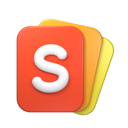

<div align="center">



# SkillDeck

**English** · [简体中文](README.zh-CN.md)

Manage all your Agent skills in one place.

[Download for macOS / Windows](https://skilldeck.cc) · [Run from source](#run-from-source) · [Command line](#command-line) · [Project structure](#project-structure)

</div>

## Features

- **Manage skills across your agents**: Claude Code, Codex, Cursor, Gemini CLI, GitHub Copilot, and other common agents work out of the box. Add custom paths to connect more tools, without tracking down each agent's skill directory yourself.
- **Paste a source, choose what to install**: Paste a GitHub repository, a local folder path, or an `npx skills add` command from a README. Preview the skills inside, then choose what to install. Pasted commands are parsed for their source and options, never executed as shell commands. Other Git and Well-known sources are also supported.
- **Enable globally or per project**: Choose which agents can use each skill, across projects or only in a specific project. Automatic global activation prefers symlinks, with a copy fallback when needed; project activation uses copies. SkillDeck places the files where each agent expects them.
- **Bring your existing skills**: Discover skills already installed in your agent folders and bring them under unified management. When copies differ, you choose which one to keep instead of having it silently overwritten. Search, favorites, notes, and personal tags keep your everyday skills organized.
- **Read skills in your language**: Translate a `SKILL.md` on demand and read the original alongside the translation. Translations are cached separately and never modify skill files or replace the content agents use. Online translation uses the service you configure.
- **Follow upstream updates, keep your changes**: Check for source changes and update individual skills or multiple skills from the Updates page. Local drafts, customization merges, conflict handling, and revision history help you manage changes. Edits made outside the App can also be inspected, then kept, restored, or exported.
- **Let your agent help manage skills**: Use the `skilldeck` CLI to query, install, activate, and check for updates in the same workspace as the desktop interface. Deletion and source replacement still require approval in the App; the command line does not bypass confirmation.

## Get started

Download the macOS or Windows installer from **[skilldeck.cc](https://skilldeck.cc)**.

1. **Collect**: add a skill source or bring existing skills in your agent directories under management.
2. **Organize**: read the content and add favorites, tags, and notes.
3. **Activate**: choose the agents that need the skill and whether to activate it globally or for a project.
4. **Maintain**: check for updates as needed. To customize a skill, edit a draft and then publish it locally.

> [!TIP]
> **Deactivating is not deleting.** Deactivation removes the agent-visible entry while keeping the skill in your collection for later use. Agents that share the same skill directory share activation state.

## Local-first, with explicit changes

- **Your workspace stays local**: skill content, revision history, favorites, tags, and notes are managed locally. Cloud sync and team workspaces are not currently available.
- **Drafts do not take effect immediately**: unpublished edits do not change the version agents use. Publishing applies changes locally, not to the upstream repository. All activations of a skill use the same published version.
- **Updates stay under your control**: checking for updates does not apply them. If a merge conflict occurs, the current effective version remains in place until you resolve it.
- **Operations support recovery**: installation, publishing, updates, and deletion use workspace operations with transaction records and recovery mechanisms, rather than simply overwriting directories.
- **Translation leaves the original intact**: network translation requires an explicit action and configuration, and sends the selected content to your configured service. Credentials use platform-secure storage; translation caches are separate from skill content.

> [!IMPORTANT]
> SkillDeck's workspace engine does not execute skill content, but that does not make imported instructions or scripts trustworthy. Review their source and content before letting an agent use them. Deleting skills and replacing sources are destructive operations; revision history is not an independent backup.

## Command line

Open **Settings → Command Line** in the App to check the CLI status and follow the instructions to configure your `PATH`. Once available:

```sh
skilldeck help
skilldeck status
skilldeck list --all
skilldeck list --favorite --json
skilldeck update --all --check
```

The last command only checks for updates; it does not apply them. Use `skilldeck help <command>` for the full options.

The CLI is a local client for the desktop App, **not a standalone workspace engine**. Management commands require the App to run. The CLI attempts to launch an installed App unless you pass `--no-launch`. The `help` and `version` commands do not need an App connection.

Requests such as deletion and source replacement require approval in the App; no CLI flag bypasses that approval. Do not start a second process that directly opens the same Workspace while the App is running.

## Run from source

### Prerequisites

Use **Flutter 3.47.5 / Dart 3.13.4** and install the Flutter desktop toolchain for your platform. Run `flutter doctor -v` to check your environment.

| Platform | Build dependencies |
| --- | --- |
| macOS | Xcode and its command-line tools, CocoaPods, and native build tools: `clang`, `cmake`, `ninja`, `pkg-config` |
| Windows | Visual Studio with **Desktop development with C++**, the Windows SDK, and C++ CMake tools. Native builds use Visual Studio's MSVC, CMake, and Ninja, not Unix `clang` / `pkg-config` |

Dependency resolution also requires Git and network access. The workspace compiles the repository's pinned libgit2 through Native Assets, so the first build can take longer. Linux support is limited to the underlying `skills_workspace` package; it is not a desktop App release target.

### Start the desktop App

From the repository root:

```sh
cd skills_manager
flutter pub get --enforce-lockfile
flutter run -d macos
```

On Windows, replace the last line with `flutter run -d windows`. Keep the committed dependency lockfiles. No private UI repository or local path override is needed.

Normal development runs **do not require `debug.json`, signing keys, or other private configuration**. App self-updates remain disabled when `SKILLDECK_UPDATE_FEED_URL` is unset. If you configure an update feed, pass only non-secret configuration; never put service credentials in source code or `--dart-define` values.

### Run the CLI from source

Keep the desktop App running, then open another terminal at the repository root:

```sh
cd packages/skilldeck_cli
dart pub get --enforce-lockfile
dart run bin/skilldeck.dart help
dart run bin/skilldeck.dart status --no-launch
```

### Validate changes

For the App, run from `skills_manager/`:

```sh
dart format --output=none --set-exit-if-changed .
flutter analyze --fatal-infos --no-pub
flutter test --no-pub
```

For the workspace engine, run from `packages/skills_workspace/`:

```sh
dart pub get --enforce-lockfile
dart analyze --fatal-infos
dart test -j 1
dart test -j 1 integration_test
```

The `-j 1` option prevents native compilation and parallel test workers from competing for memory. The translation package uses `flutter test`, not `dart test`, and separately maintains compatibility with Flutter 3.29.3.

> [!NOTE]
> GitHub-hosted CI is configured, but this snapshot has not yet been verified by remote runs. While the repository is private, runs consume the owner's included Actions minutes and may incur charges; configuration is not evidence of passing tests or release readiness.

CI is path-filtered by component. Pull requests run Linux quick checks (formatting, strict analysis, complete unit tests, plus Workspace generation and native integration). Pushes to `main` add macOS arm64 (`macos-15`), Windows x64 (`windows-2022`), and Linux x64 (`ubuntu-24.04`) verification. App desktop E2E runs only on macOS and Windows; Linux App checks are unit/static checks, not a delivery target. Workspace desktop integration also runs headlessly on Linux. macOS Intel verification remains deferred.

The SDK is pinned to Flutter **3.47.5 / Dart 3.13.4**. Translation and its example additionally analyze and test on Flutter **3.29.3**, including an example Linux Debug build. Main verification includes Workspace's 85% coverage and native ABI gates, and translation example Debug builds on all three platforms.

Workspace and App workflows accept manual `quick` or `merge` verification from the Actions tab; CLI and Translation manual runs verify all supported platforms. There are **no tag-triggered release, signing, notarization, deployment, or publication jobs**, and no private UI credentials are required. macOS tests use only a local ad-hoc Debug identity. Stale PR runs are canceled; main runs are not. No build artifacts or private logs are uploaded.

Workflow policy can be checked offline with `ruby .github/tests/workflow_policy_test.rb`; workflow syntax can be checked with `actionlint .github/workflows/*.yml`. Standard runner architecture references: [GitHub-hosted runners](https://docs.github.com/en/actions/reference/runners/github-hosted-runners).

## Project structure

| Path | Responsibility |
| --- | --- |
| [`skills_manager/`](skills_manager/) | Flutter desktop App: interface, settings, workspace orchestration, and local command host |
| [`packages/skills_workspace/`](packages/skills_workspace/) | Transactional skill lifecycle, activation, SQLite metadata, and native Git revision engine |
| [`packages/skills_translation/`](packages/skills_translation/) | Independent Markdown translation and content-addressed cache |
| [`packages/skilldeck_cli/`](packages/skilldeck_cli/) | The `skilldeck` CLI and local App communication protocol |
| [`release/`](release/), [`tool/`](tool/) | Build and release helpers; releases still require separately configured signing and distribution environments |

Start with the [Context Map](CONTEXT-MAP.md) for module boundaries. See [Skill Workspace](CONTEXT.md) for workspace terminology and behavior contracts.
